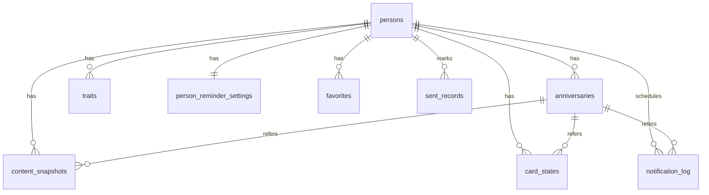

# AI 心意管家 · 第一版数据模型（data-model.md）

> 本文件依据 `spec.md` 与 `plan.md` 设计，是二者数据层的细化，不新增功能、不改写已有命名。表名、字段名与 `plan.md` 第 4 节完全一致；spec/plan 未明确要求的字段仅为满足功能而补充。
>
> 存储分两期（plan 第 〇 节、阶段 10）：阶段 0–9 使用本机 **Expo SQLite**；阶段 10 登录后启用 **Supabase Postgres**，两期通过 Repository 接口切换，本模型按同一套表结构设计。

---

## 1. 总体约定

### 1.1 类型映射（SQLite ↔ Supabase Postgres）

| 逻辑类型 | SQLite（本机） | Postgres（云端） |
| --- | --- | --- |
| 主键 / 外键 ID | `TEXT`（存 UUID 字符串） | `uuid` |
| 枚举 | `TEXT` + 应用层校验（必要时 `CHECK`） | `text` + `CHECK`（或后续改 enum） |
| 整数（月、日、年份、条数、状态计数等） | `INTEGER` | `integer` |
| 布尔 | `INTEGER`（0/1） | `boolean` |
| JSON 结构（blessings / gifts / payload） | `TEXT`（JSON 字符串） | `jsonb` |
| 时间戳 | `TEXT`（ISO 8601，UTC 存储） | `timestamptz` |
| 业务年份 `year` | `INTEGER` | `integer` |

- 主键统一使用应用层生成的 UUID（plan 4.1）。
- 业务日期一律按**设备本地日期和时区**计算（spec 全局规则 2）；`year` 为本地年份，时间戳列存 UTC 仅用于记录创建/生成时刻。
- 可空列一律允许 `NULL`，不用空字符串表达"未填"。

### 1.2 表与同步范围

spec 第 14 条明确登录后上云的数据为：人员档案、纪念日、特征、心意快照、贺卡组合状态、收藏、往年记录。据此分为两组：

| 表名 | 含义 | 阶段 10 是否上云 |
| --- | --- | --- |
| `persons` | 人员档案 | 是 |
| `anniversaries` | 纪念日 | 是 |
| `traits` | 特征描述 | 是 |
| `content_snapshots` | 祝福与礼物的当年快照 | 是 |
| `card_states` | 贺卡组合状态 | 是 |
| `favorites` | 收藏（历史 Tab 收藏分区） | 是 |
| `sent_records` | 「今年已送出」/ 往年记录 | 是 |
| `app_settings` | 应用设置 | 否（仅本机，spec 第 14 条未列入上云范围） |
| `person_reminder_settings` | 单人提醒覆盖 | 否（同上） |
| `festival_settings` | 节日提醒开关 | 否（同上） |
| `notification_log` | 提醒调度/去重/补发运行数据 | 否（纯本机运行状态） |

- 上云的 7 张表在本机库中也**预留 `user_id` 列（本机阶段可为 NULL）**，并统一带 `created_at`、`updated_at`、`deleted`，使两期 DDL 尽量一致（见第 9 节）。
- 仅本机的 4 张表不带 `user_id`。
- 内置节日固定在代码中（六个），**不建用户可增删的节日表**；`festival_settings` 仅存开关。

### 1.3 枚举值对照

存储用英文代号（与 plan 路由中的 `kind=birthday|anniversary|festival` 风格一致），含义对照 spec/plan 原文：

| 列 | 存储值 | spec/plan 含义 |
| --- | --- | --- |
| `persons.relation` | `家人` / `挚友` / `客户` / `其他` | 与自己的关系（固定枚举，原样存中文） |
| `content_snapshots.occasion_type` | `birthday` / `anniversary` / `festival` | 生日 / 纪念日 / 节日 |
| `card_states.occasion_type` | 同上 | 同上 |
| `favorites.kind` | `blessing` / `gift` / `card` | 祝福 / 礼物 / 贺卡 |
| `sent_records.kind` | `blessing` / `gift` / `card` | 祝福 / 礼物 / 贺卡 |
| `notification_log.occasion_type` | `birthday` / `anniversary` / `festival` | 生日 / 纪念日 / 节日 |
| `content_snapshots.status` | `pending` / `success` / `failed` | 未生成 / 成功 / 失败 |
| `notification_log.status` | `scheduled` / `delivered` / `made_up` | 已调度 / 已送达 / 已补发 |
| `app_settings.ai_consent` | `pending` / `agreed` / `declined` | 未表态 / 同意并生成 / 暂不同意 |

节日代号 `festival_code`（与页面展示名一一对应，展示名固定不改写）：

| `festival_code` | 节日 | 日期规则（spec 第 7 条） |
| --- | --- | --- |
| `new_year` | 元旦 | 1 月 1 日 |
| `valentines_day` | 情人节 | 2 月 14 日 |
| `mothers_day` | 母亲节 | 五月第二个星期日 |
| `fathers_day` | 父亲节 | 六月第三个星期日 |
| `thanksgiving` | 感恩节 | 十一月第四个星期四 |
| `christmas` | 圣诞节 | 12 月 25 日 |

---

## 2. 数据表

### 2.1 `persons`（人员档案）

| 字段名 | 类型 | 必填 | 默认 | 说明 |
| --- | --- | --- | --- | --- |
| `id` | UUID | 是 | 生成 | 主键 |
| `name` | TEXT | 是 | — | 姓名；允许与已有人员重名 |
| `relation` | TEXT | 是 | — | 与自己的关系：`家人` / `挚友` / `客户` / `其他` |
| `birthday_month` | INTEGER | 是 | — | 生日月（1–12） |
| `birthday_day` | INTEGER | 是 | — | 生日日（1–31）；填 2 月 29 日时平年由日子引擎按 2 月 28 日处理，数据不改存 |
| `birth_year` | INTEGER | 否 | NULL | 出生年份，仅用于内部理解人生阶段；祝福与贺卡默认不出现具体年龄或岁数 |
| `salutation` | TEXT | 否 | NULL | 「你怎么称呼 TA」，用于贺卡抬头；未填时贺卡使用 `name` |
| `signature` | TEXT | 否 | NULL | 「你的自称」，用于祝福自动落款与贺卡角落落款；未填则不落款、不留白 |
| `user_id` | UUID | 否 | NULL | 云端归属用户；本机阶段为 NULL，阶段 10 云端 NOT NULL |
| `created_at` | TIMESTAMP | 是 | 当前时间 | 创建时间 |
| `updated_at` | TIMESTAMP | 是 | 当前时间 | 修改时间；手动「重新生成」不改本字段（档案修改才改） |
| `deleted` | BOOLEAN | 是 | 0 | 云端软删标记；本机按 spec 第 2 条物理级联删除（见第 8 节） |

### 2.2 `anniversaries`（纪念日，一人可多个）

| 字段名 | 类型 | 必填 | 默认 | 说明 |
| --- | --- | --- | --- | --- |
| `id` | UUID | 是 | 生成 | 主键 |
| `person_id` | UUID | 是 | — | 外键 → `persons.id` |
| `name` | TEXT | 是 | — | 名称，可自定义，如「领证日」「乔迁」 |
| `month` | INTEGER | 是 | — | 月（1–12） |
| `day` | INTEGER | 是 | — | 日（1–31，日期合法性由应用层校验） |
| `start_year` | INTEGER | 否 | NULL | 起始年份；填写后祝福中可出现具体周年数（如「十周年快乐」），未填只写纪念日名称、不杜撰年份 |
| `user_id` | UUID | 否 | NULL | 云端归属用户 |
| `created_at` | TIMESTAMP | 是 | 当前时间 | — |
| `updated_at` | TIMESTAMP | 是 | 当前时间 | — |
| `deleted` | BOOLEAN | 是 | 0 | 云端软删标记 |

### 2.3 `traits`（特征描述，一人 0–5 条）

| 字段名 | 类型 | 必填 | 默认 | 说明 |
| --- | --- | --- | --- | --- |
| `id` | UUID | 是 | 生成 | 主键 |
| `person_id` | UUID | 是 | — | 外键 → `persons.id` |
| `content` | TEXT | 是 | — | 一条特征，如「爱养花，今年刚退休」；应用层强制单条不超过 30 字、每人最多 5 条；整表可为该人 0 行 |
| `position` | INTEGER | 是 | 0 | 顺序位，从 0 起，按用户填写顺序展示 |
| `user_id` | UUID | 否 | NULL | 云端归属用户 |
| `created_at` | TIMESTAMP | 是 | 当前时间 | — |
| `updated_at` | TIMESTAMP | 是 | 当前时间 | — |
| `deleted` | BOOLEAN | 是 | 0 | 云端软删标记 |

### 2.4 `app_settings`（应用设置，本机单行表）

固定一行（`id = 1`）。未列入 spec 第 14 条上云范围，仅本机保存（所有设置保存后持续生效，不因重开 App 丢失）。

| 字段名 | 类型 | 必填 | 默认 | 说明 |
| --- | --- | --- | --- | --- |
| `id` | INTEGER | 是 | 1 | 固定主键 |
| `global_advance_days` | INTEGER | 是 | 3 | 全局默认提前天数；只接受 1–30 的整数，不能为 0；首次使用默认为三天 |
| `delivery_hour` | INTEGER | 是 | 9 | 提醒送达钟点（24 小时制整点，默认上午 9:00）；调整后对所有尚未送达的提醒立即生效 |
| `blessing_count` | INTEGER | 是 | 3 | 祝福条数，默认三条；改为 N 仅对新生成的快照生效 |
| `ai_consent` | TEXT | 是 | `pending` | 首次 AI 生成告知选择：`agreed` 后不再弹告知；`declined` 后下次点击生成可再次看到告知 |

### 2.5 `person_reminder_settings`（某人的提醒覆盖，与人员一对一）

| 字段名 | 类型 | 必填 | 默认 | 说明 |
| --- | --- | --- | --- | --- |
| `person_id` | UUID | 是 | — | 主键，外键 → `persons.id` |
| `advance_days` | INTEGER | 否 | NULL | 单独覆盖天数，1–30 的整数；一旦设置，同时覆盖该人的生日与全部纪念日；NULL 表示跟随全局默认 |
| `disabled` | BOOLEAN | 是 | 0 | 单独关闭某人提醒：关闭后仅停止该人推送，其日子仍出现在提醒页日子列表、当天提示与节日选人列表中 |

（不提供按单个生日/纪念日设置天数或开关的字段。）

### 2.6 `festival_settings`（内置节日关注状态，每节日一行；F11）

| 字段名 | 类型 | 必填 | 默认 | 说明 |
| --- | --- | --- | --- | --- |
| `festival_code` | TEXT | 是 | — | 主键，六个预置值之一（见 1.3）；App 初始化写入六行，默认全部关注 |
| `disabled` | BOOLEAN | 是 | 0 | 关注/取关状态：`0`=已关注，`1`=已取关。取关后不推送、不在提醒页节日倒计时区显示、无入口进入节日心意；重新关注恢复。取关不溯及既往：已收藏/已送出的该节日内容保留。操作入口在提醒页节日区，设置页无节日开关 |

（节日统一使用全局提前天数，不设单个节日的天数字段。列名 `disabled` 沿用 M2 建表，2026-10-30 仅语义变更，无结构迁移。）

### 2.7 `content_snapshots`（祝福与礼物的当年快照）

粒度为**「人 × 日子 × 年份」**；通用节日（未选人）时 `person_id` 为 NULL。首次需要时生成一次，当年固定；推送点开与提醒页点开读同一行。

| 字段名 | 类型 | 必填 | 默认 | 说明 |
| --- | --- | --- | --- | --- |
| `id` | UUID | 是 | 生成 | 主键 |
| `person_id` | UUID | 否 | NULL | 外键 → `persons.id`；通用节日通用版为 NULL |
| `occasion_type` | TEXT | 是 | — | `birthday` / `anniversary` / `festival` |
| `anniversary_id` | UUID | 否 | NULL | 纪念日日子时外键 → `anniversaries.id`；其他类型为 NULL |
| `festival_code` | TEXT | 否 | NULL | 节日日子时取六个代号之一；其他类型为 NULL |
| `year` | INTEGER | 是 | — | 本地年份 |
| `blessings` | JSON | 否 | NULL | 祝福完整文案数组（结构见 3.1），条数取生成时的 `blessing_count`；连续 3 次失败后存不针对个人的通用兜底文案 |
| `gifts` | JSON | 否 | NULL | 礼物建议数组（不少于五个，结构见 3.2）；通用版节日无礼物，保持 NULL；字段细节随 A1 拍板 |
| `status` | TEXT | 是 | `pending` | `pending`（未生成）/ `success`（成功）/ `failed`（失败）；无网络且未生成时页面显示「需要网络」+ 手动重试 |
| `fail_count` | INTEGER | 是 | 0 | 连续生成失败次数；祝福达到 3 次时改用通用兜底文案，网络恢复后可重新生成覆盖 |
| `generated_at` | TIMESTAMP | 否 | NULL | 最近一次成功生成（或兜底写入）时间 |
| `user_id` | UUID | 否 | NULL | 云端归属用户 |
| `created_at` | TIMESTAMP | 是 | 当前时间 | — |
| `updated_at` | TIMESTAMP | 是 | 当前时间 | 手动「重新生成」替换内容时更新 |
| `deleted` | BOOLEAN | 是 | 0 | 云端软删标记 |

约束：

- 唯一键（见 7.2）保证同一「人 × 日子 × 年份」只有一行。
- `occasion_type='birthday'`：`person_id` 必填，纪念日/节日列为 NULL。
- `occasion_type='anniversary'`：`person_id`、`anniversary_id` 必填。
- `occasion_type='festival'`：`festival_code` 必填，`person_id` 可空；`person_id` 为空即通用版（仅祝福、无礼物）。
- 修改人物资料或调整祝福条数不自动改本行；用户点「重新生成」才替换（按钮粒度随 B 组问题定）。

### 2.8 `card_states`（贺卡组合状态，按「人 × 日子 × 年份」）

| 字段名 | 类型 | 必填 | 默认 | 说明 |
| --- | --- | --- | --- | --- |
| `id` | UUID | 是 | 生成 | 主键 |
| `person_id` | UUID | 否 | NULL | 外键 → `persons.id`；通用节日通用版为 NULL |
| `occasion_type` | TEXT | 是 | — | `birthday` / `anniversary` / `festival` |
| `anniversary_id` | UUID | 否 | NULL | 纪念日时外键 → `anniversaries.id` |
| `festival_code` | TEXT | 否 | NULL | 节日时代号 |
| `year` | INTEGER | 是 | — | 本地年份 |
| `template_code` | TEXT | 是 | 内置默认模板代号 | 模板选择；不少于三套风格明显不同的内置模板；首次打开详情自动组合时写入，无单独「生成」按钮 |
| `selected_index` | INTEGER | 是 | 0 | 选中第几条祝福文案，进入时默认第一条（0）；左右切换后保留 |
| `edited_text` | TEXT | 否 | NULL | 用户自行编辑后的祝福文字；为空表示直接使用 `selected_index` 对应原文；编辑即时反映在贺卡上，导出图片使用当前内容；模板切换不丢失 |
| `user_id` | UUID | 否 | NULL | 云端归属用户 |
| `created_at` | TIMESTAMP | 是 | 当前时间 | — |
| `updated_at` | TIMESTAMP | 是 | 当前时间 | — |
| `deleted` | BOOLEAN | 是 | 0 | 云端软删标记 |

说明：称呼取自 `persons.salutation`（未填用 `name`），落款取自 `persons.signature`（未填整块不显示），均为渲染时读取，不在本表冗余。祝福快照尚不存在时贺卡文字如何呈现，随 **A2** 拍板后补充状态约定（不新增表）。

### 2.9 `favorites`（收藏，历史 Tab「收藏」分区）

| 字段名 | 类型 | 必填 | 默认 | 说明 |
| --- | --- | --- | --- | --- |
| `id` | UUID | 是 | 生成 | 主键 |
| `kind` | TEXT | 是 | — | `blessing` / `gift` / `card` |
| `person_id` | UUID | 否 | NULL | 外键 → `persons.id`；通用版内容为 NULL |
| `person_label` | TEXT | 否 | NULL | 收藏时刻的对象显示信息快照（如「张伟（客户）」）；通用版固定显示「通用（未指定人）」 |
| `occasion_type` | TEXT | 是 | — | `birthday` / `anniversary` / `festival`，用于标明为什么日子收藏 |
| `anniversary_id` | UUID | 否 | NULL | 纪念日时引用 |
| `festival_code` | TEXT | 否 | NULL | 节日时代号 |
| `occasion_name` | TEXT | 是 | — | 日子名称展示快照（如「生日」「领证日」「母亲节」） |
| `year` | INTEGER | 是 | — | 收藏时的本地年份 |
| `payload` | JSON | 是 | — | 收藏那一刻的完整快照（结构见第 3 节）：祝福全文；礼物的名称、理由与搜索词；贺卡的模板与图文。当年快照之后被重新生成不影响本行，可离线查看 |
| `user_id` | UUID | 否 | NULL | 云端归属用户 |
| `created_at` | TIMESTAMP | 是 | 当前时间 | 收藏时间 |
| `updated_at` | TIMESTAMP | 是 | 当前时间 | — |
| `deleted` | BOOLEAN | 是 | 0 | 云端软删标记 |

说明：去重、排序规则与是否设容量上限随 B 组问题定，故除 `created_at` 外不预设唯一约束；取消收藏只删本行，不影响心意详情中的原内容。与「已送出」是否两套独立数据随 **A5** 拍板，当前按相互独立设计。

### 2.10 `sent_records`（「今年已送出」/ 往年记录）

按 plan 4.2 的初步字段设计为**按祝福/礼物/贺卡条目分别标记**（允许只送一样）；该结构及是否允许提前/事后补标属 **A4**，阶段 9 开工前拍板后定稿。

本表同时是 **F17 历史 Tab「已送出」全局流水**的数据源：跨人跨年按 `marked_at` 倒序聚合；取关节日不影响已有行；人物删除时相关行级联消失。

| 字段名 | 类型 | 必填 | 默认 | 说明 |
| --- | --- | --- | --- | --- |
| `id` | UUID | 是 | 生成 | 主键 |
| `person_id` | UUID | 是 | — | 外键 → `persons.id`；通用版标记「已送出」前必须先选择一位已录入的人，标记后归属所选的人 |
| `occasion_type` | TEXT | 是 | — | `birthday` / `anniversary` / `festival` |
| `anniversary_id` | UUID | 否 | NULL | 纪念日时引用 |
| `festival_code` | TEXT | 否 | NULL | 节日时代号 |
| `year` | INTEGER | 是 | — | 标记时的本地年份，自动关联 |
| `kind` | TEXT | 是 | — | `blessing` / `gift` / `card` |
| `payload` | JSON | 是 | — | 标记那一刻的快照（结构同 `favorites.payload`）；当年快照之后被重新生成，本行仍完整保留并可在回顾区查看 |
| `marked_at` | TIMESTAMP | 是 | 当前时间 | 标记时间；撤销即删除本行，更改则更新本行 |
| `user_id` | UUID | 否 | NULL | 云端归属用户 |
| `created_at` | TIMESTAMP | 是 | 当前时间 | — |
| `updated_at` | TIMESTAMP | 是 | 当前时间 | — |
| `deleted` | BOOLEAN | 是 | 0 | 云端软删标记（撤销标记时使用） |

### 2.11 `notification_log`（提醒调度与去重，纯本机运行数据）

不上云。保证同一个日子在同一年份只送达一条，并支撑关机/离线恢复后补发一次。

| 字段名 | 类型 | 必填 | 默认 | 说明 |
| --- | --- | --- | --- | --- |
| `id` | UUID | 是 | 生成 | 主键 |
| `occasion_type` | TEXT | 是 | — | `birthday` / `anniversary` / `festival` |
| `person_id` | UUID | 否 | NULL | 生日/纪念日时引用 `persons.id`；节日为 NULL |
| `anniversary_id` | UUID | 否 | NULL | 纪念日时引用 `anniversaries.id` |
| `festival_code` | TEXT | 否 | NULL | 节日时代号 |
| `year` | INTEGER | 是 | — | 本地年份 |
| `scheduled_at` | TIMESTAMP | 是 | — | 计划送达时刻（本地）：日子前第 N 天的 `delivery_hour` 点；N 取全局默认或该人覆盖天数，节日取全局天数 |
| `status` | TEXT | 是 | `scheduled` | `scheduled`（已调度）/ `delivered`（已送达）/ `made_up`（已补发） |
| `is_made_up` | BOOLEAN | 是 | 0 | 离线补发标记：因设备关机或离线错过、恢复后补发一次置 1；其余错过情况不补推 |
| `os_notification_id` | TEXT | 否 | NULL | 系统通知标识，用于取消/重排 |
| `delivered_at` | TIMESTAMP | 否 | NULL | 实际送达（或补发）时间 |
| `created_at` | TIMESTAMP | 是 | 当前时间 | — |
| `updated_at` | TIMESTAMP | 是 | 当前时间 | — |

说明：同一天多个日子到达提醒时点时，在调度层合并为一条通知，payload 携带当天全部日子的路由参数（单个 → 心意详情/节日选人页；多个 → 当日清单页）；合并是运行时行为，本表仍按日子逐行登记以做去重。

---

## 3. JSON 结构

### 3.1 `content_snapshots.blessings`

字符串数组，长度为生成时的 `app_settings.blessing_count`（兜底文案同结构）：

```json
["祝福文案一", "祝福文案二", "祝福文案三"]
```

### 3.2 `content_snapshots.gifts`

数组，成功时不少于五个元素。以下为当前默认结构（纯文字 + 理由 + 跳转），搜索词来源、是否含价格与图片随 **A1** 拍板：

```json
[
  {
    "name": "礼物名称或方向",
    "reason": "为什么适合 TA（与该人特征或节日主题相关）",
    "search_term": "电商搜索词"
  }
]
```

### 3.3 `favorites.payload` 与 `sent_records.payload`

按 `kind` 保存收藏/标记那一刻的完整快照：

- `kind = "blessing"`：

  ```json
  { "text": "祝福全文" }
  ```

- `kind = "gift"`：

  ```json
  { "name": "礼物名称或方向", "reason": "为什么适合 TA", "search_term": "电商搜索词" }
  ```

- `kind = "card"`：保存贺卡的模板与图文（画布比例/分辨率随 **A3** 定，导出参数不入库）：

  ```json
  {
    "template_code": "模板代号",
    "salutation": "渲染时称呼，未填则为姓名",
    "text": "导出时使用的祝福文字（含用户编辑结果）",
    "signature": "渲染时自称，未填为 null 且落款整块不显示",
    "occasion_type": "birthday | anniversary | festival",
    "occasion_name": "生日 / 领证日 / 母亲节 等"
  }
  ```

  贺卡图片本身不入库、不入云端 Storage，按 spec 第 10 条在本机组合导出。

---

## 4. 表与表的关系

| 关系 | 基数 | 外键 | 删除行为（本机，spec 第 2 条） |
| --- | --- | --- | --- |
| `persons` → `anniversaries` | 一对多 | `anniversaries.person_id` | 级联删除 |
| `persons` → `traits` | 一对多 | `traits.person_id` | 级联删除 |
| `persons` → `person_reminder_settings` | 一对一 | `person_reminder_settings.person_id` | 级联删除 |
| `persons` → `content_snapshots` | 一对多（生日/纪念日/选定人的节日） | `content_snapshots.person_id` | 级联删除 |
| `persons` → `card_states` | 一对多 | `card_states.person_id` | 级联删除 |
| `persons` → `favorites` | 一对多（通用版收藏为零关联） | `favorites.person_id` | 级联删除；`person_label` 等展示快照保留在 payload/标签列中仅随本行删除 |
| `persons` → `sent_records` | 一对多 | `sent_records.person_id` | 级联删除 |
| `persons` → `notification_log` | 一对多（节日行为零关联） | `notification_log.person_id` | 级联删除并取消其待送达通知 |
| `anniversaries` → `content_snapshots` / `card_states` / `notification_log` | 一对多 | `anniversary_id` | 随人员删除；纪念日本身被删时相关行一并清理 |
| 六个内置节日（代码常量）→ `festival_settings` | 一对一 | `festival_code` | 代码常量不删，仅切换 `disabled` |
| 六个内置节日 → `content_snapshots` / `card_states` / `notification_log` | 一对多 | `festival_code` | 逻辑关联，无数据库外键（常量在代码中） |

删除人员时一次性消失（二次确认已告知用户）：档案、纪念日、特征、快照、贺卡状态、单人提醒设置、收藏条目、往年记录、待送达提醒；该人不再出现在任何列表、推送、收藏或历史记录中。

关系示意：



（节日为代码常量，经 `festival_code` 与 `festival_settings`、`content_snapshots`、`card_states`、`notification_log` 关联，不建实体表。）

---

## 5. 关键索引

### 5.1 主键与唯一约束

| 表 | 约束 |
| --- | --- |
| 全部上云表 | `PRIMARY KEY (id)`（UUID） |
| `app_settings` | `PRIMARY KEY (id)`，单行 id=1 |
| `person_reminder_settings` | `PRIMARY KEY (person_id)` |
| `festival_settings` | `PRIMARY KEY (festival_code)` |
| `content_snapshots` | 「人 × 日子 × 年份」唯一，见 7.2 表达式唯一索引 |
| `card_states` | 同上 |
| `notification_log` | 「日子 × 年份」唯一，见 7.2 |
| `sent_records` | 初步唯一：(`person_id`, `occasion_type`, COALESCE(`anniversary_id`), COALESCE(`festival_code`), `year`, `kind`)；随 **A4** 定稿 |

### 5.2 查询索引

| 表 | 索引 | 用途 |
| --- | --- | --- |
| `anniversaries` | `(person_id)` | 人员详情读取全部纪念日 |
| `traits` | `(person_id, position)` | 按顺序读取特征 |
| `content_snapshots` | `(person_id, occasion_type, year)` | 提醒页/详情查当年快照；另见唯一索引覆盖 |
| `content_snapshots` | `(status)` | 失败重试、待生成扫描（数据量小，可选） |
| `card_states` | `(person_id, occasion_type, year)` | 进详情时取贺卡状态 |
| `favorites` | `(kind, created_at)` | 历史 Tab 收藏分区列表（类型区分 + 时间排序） |
| `favorites` | `(person_id)` | 删除人员时级联定位 |
| `sent_records` | `(person_id, occasion_type, COALESCE(anniversary_id), COALESCE(festival_code), year DESC)` | 心意详情按年份倒序展示往年记录 |
| `notification_log` | `(status, scheduled_at)` | 重算调度、启动时补发扫描 |
| 上云表（阶段 10） | 每张表 `(user_id)` 及上述组合索引前置 `user_id` | RLS 下按用户查询 |

SQLite 中 COALESCE 表达式与 Postgres 兼容，迁移时可直接改写为同名表达式索引。

---

## 6. 日子数据的运行时派生

生日、纪念日、六个节日在年度内的具体日期不建表，由日子计算引擎（plan 4.3）按设备本地日期实时派生：

- 生日 2 月 29 日：平年按 2 月 28 日、闰年按 2 月 29 日；
- 母亲节 / 父亲节 / 感恩节按星期规则逐年计算；
- 提醒页列表、提醒时点（前第 N 天 + `delivery_hour`）、`year` 均由引擎输出后再与各表关联；节日输出按 `festival_settings.disabled` 过滤取关项（F11）。

---

## 7. Supabase 接入准备（阶段 10）

### 7.1 表结构对齐

- 7 张上云表在 Postgres 中使用同名字段：UUID→`uuid`，JSON→`jsonb`，布尔→`boolean`，时间戳→`timestamptz`。
- 每张上云表云端 NOT NULL 追加：`user_id uuid references auth.users(id)`、`updated_at timestamptz`、`deleted boolean not null default false`；本机库对应列预留（`user_id` 本机可空、`deleted` 默认 0）。
- `relation`、`occasion_type`、`kind`、`status`、`ai_consent`、`festival_code` 在 Postgres 用 `CHECK` 约束，取值与第 1.3 节完全一致。

### 7.2 可空外键的唯一索引（人与通用版共存）

`content_snapshots` / `card_states` / `notification_log` 的日子定位列含 NULL（通用节日 `person_id` 为空、非纪念日 `anniversary_id` 为空），唯一约束用 COALESCE 表达式，SQLite 与 Postgres 写法同构：

```sql
-- content_snapshots / card_states：人 × 日子 × 年份
CREATE UNIQUE INDEX ux_snapshot_occasion
ON content_snapshots (
  COALESCE(user_id, '00000000-0000-0000-0000-000000000000'),
  COALESCE(person_id, '00000000-0000-0000-0000-000000000000'),
  occasion_type,
  COALESCE(anniversary_id, '00000000-0000-0000-0000-000000000000'),
  COALESCE(festival_code, ''),
  year
);
```

`card_states` 同构；`notification_log` 去掉 `user_id`（不上云）。阶段 10 云端索引以 `user_id` 领先，保证不同用户的通用版节日快照互不冲突。

### 7.3 RLS 策略

每张上云表启用行级安全，统一策略：

```sql
create policy "仅本人可读" on <table>
  for select using (auth.uid() = user_id);
create policy "仅本人可写入" on <table>
  for insert with check (auth.uid() = user_id);
create policy "仅本人可修改" on <table>
  for update using (auth.uid() = user_id) with check (auth.uid() = user_id);
create policy "仅本人可删除" on <table>
  for delete using (auth.uid() = user_id);
```

外键关系（纪念日、特征等）在云端通过应用层 Repository 保证同属一个 `user_id`；删除人员在云端按 **A6** 定稿的策略软删/级联。

### 7.4 Repository 与离线

- 所有读写经 Repository 接口（plan 1.1、4.5）：未登录注入 SQLite 实现；登录后按 A6 策略做首次迁移/合并，之后以 SupabaseRepository 访问、本机保留缓存，已生成快照无网络时仍可完整查看。
- Edge Functions（DeepSeek 网关）阶段 10 后校验登录用户 JWT，未登录仍保留匿名限频通道；AI 生成结果最终仍写入上述同结构快照表。
- `app_settings`、`person_reminder_settings`、`festival_settings`、`notification_log` 不迁移、不上云（第 1.2 节）；换机后这些本机设置按应用默认值重新初始化。

---

## 8. 待定事项对本模型的影响

| 门禁 | 影响 |
| --- | --- |
| **A1**（阶段 5 前） | 定 `gifts` 元素最终字段：搜索词由 AI 返回还是由名称拼出、是否包含价格与图片、多平台按钮形态；可能扩展 3.2 的对象结构，不新增表 |
| **A2**（阶段 7 前） | 定祝福快照不存在时贺卡文字呈现与三部分组装时序；可能为 `card_states` 增加组装状态约定，不新增表 |
| **A3**（模板开工前） | 定导出图片比例与分辨率；属模板/导出参数，不入库 |
| **A4**（阶段 9 前） | 定 `sent_records` 是否按条目标记（当前设计）还是整日子标记一次、可否提前/补标；定稿其唯一约束 |
| **A5**（阶段 8 前） | 定收藏与「已送出」是否两套独立数据；当前 `favorites` 与 `sent_records` 独立建表 |
| **A6**（阶段 10 前） | 定首次登录本机/云端数据合并与冲突策略、退出登录后本机数据去留、离线缓存口径；影响 Repository 实现与云端软删/级联，不改本文件表结构 |
